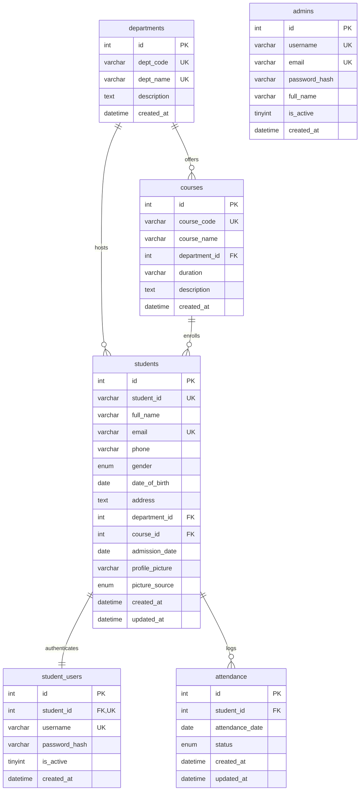

# Student Management System — Comprehensive Academic Documentation

A modern full-stack web application built using **Python 3**, **Flask**, **MySQL**, **Bootstrap 5**, and **AWS Cloud Services** (EC2, RDS, and S3).

---

## 1. Executive Summary & Architecture Overview

The **Student Management System (SMS)** is an academic cloud computing project designed to automate student administration, departmental curriculum structuring, attendance tracking, and individual student access with role-based security.

### System Architecture Diagram

```mermaid
flowchart TD
    subgraph Client Layer
        Browser["Responsive Web Client (HTML5, CSS3, JS, Bootstrap 5)"]
    end

    subgraph Presentation & Reverse Proxy
        Nginx["Nginx Reverse Proxy (Port 80/443)"]
        NginxStatic["Direct Static Cache (/static/ 30-day expiry)"]
        NginxProxy["Proxy Pass (http://127.0.0.1:8000)"]
    end

    subgraph Application Tier (AWS EC2)
        Gunicorn["Gunicorn WSGI (Workers: 2*CPU + 1)"]
        Flask["Flask Application Factory (create_app)"]
        AuthModule["RBAC Auth (Flask-Login + Werkzeug)"]
        AdminModule["Admin Operations (CRUD, Attendance, Analytics)"]
        StudentModule["Student Portal (Self-Service, History, Security)"]
        S3Service["S3 Service Wrapper (Boto3 SDK)"]
    end

    subgraph Database Tier (Amazon RDS / MySQL)
        MySQL[("MySQL 8.0+ Database\n(student_management_db)")]
        Tables["Tables: admins, students, student_users, departments, courses, attendance"]
    end

    subgraph Object Storage Tier (Amazon S3)
        S3Bucket[("Amazon S3 Bucket\n(Student Photographs)")]
    end

    Browser --> Nginx
    Nginx --> NginxStatic
    Nginx --> NginxProxy --> Gunicorn --> Flask
    Flask --> AuthModule
    Flask --> AdminModule
    Flask --> StudentModule
    AdminModule --> S3Service
    StudentModule --> S3Service
    S3Service -->|"Presigned URLs & Uploads"| S3Bucket
    Flask -->|"PyMySQL ORM Connection Pooling"| MySQL
    MySQL --- Tables
```

---

## 2. Technology Stack & Decision Rationale

| Layer | Component | Technical Selection | Academic & Engineering Rationale |
|---|---|---|---|
| **Frontend** | Markup & Styling | HTML5, CSS3, Bootstrap 5.3, Bootstrap Icons | Lightweight, responsive, corporate aesthetic without the bundle complexity of React/Node.js. |
| **Data Viz** | Charting | Chart.js 4.4 | Client-side responsive charts for enrollment trends and attendance ratios without page reloads. |
| **Backend** | Web Framework | Python 3 + Flask 3.0 | Modular application factory architecture with blueprint routing and microframework performance. |
| **ORM** | Database Layer | Flask-SQLAlchemy 3.1 + PyMySQL | High-level object relational mapping, connection pre-pinging, and protection against SQL injection. |
| **Security** | Auth & Encryption | Flask-Login + Werkzeug + Flask-WTF | Session-based authentication with PBKDF2-SHA256 password hashing and CSRF form protection. |
| **Storage** | Object Store | Amazon S3 + Boto3 SDK | High-durability profile image storage with secure, time-limited presigned URLs and EC2 IAM role support. |
| **Database** | Relational DB | Amazon RDS MySQL 8.0 / Local MySQL | ACID-compliant relational schema with foreign key integrity and composite uniqueness constraints. |
| **Server** | WSGI & Proxy | Gunicorn 22.0 + Nginx | Production-grade WSGI worker process management and high-performance static asset caching. |

---

## 3. Database Schema & Entity Relationships

The MySQL database (`student_management_db`) consists of **6 relational tables**:



### Relational Constraints:
1. **Department Deletion Protection:** Foreign keys on `courses.department_id` and `students.department_id` enforce `ON DELETE RESTRICT`. A department with assigned students or courses cannot be dropped.
2. **Course Deletion Protection:** Foreign key on `students.course_id` enforces `ON DELETE RESTRICT`. A course with enrolled students cannot be dropped.
3. **Cascading Student Removal:** Deleting a student cascades (`ON DELETE CASCADE`) to automatically purge their login account (`student_users`) and historical attendance logs (`attendance`).
4. **Attendance Uniqueness:** A composite unique constraint `UNIQUE(student_id, attendance_date)` ensures a student cannot have multiple attendance records on the same day.

---

## 4. Security & Role-Based Access Control (RBAC)

### Access Control Matrix

| Feature / Resource | Route / URL | Admin Access | Student Access | Anonymous |
|---|---|:---:|:---:|:---:|
| **Sign In** | `/login` | ✅ | ✅ | ✅ |
| **Sign Out** | `/logout` | ✅ | ✅ | ❌ |
| **Admin Dashboard** | `/admin/dashboard` | ✅ | ❌ (403) | ❌ (Redirect) |
| **Student Directory** | `/admin/students` | ✅ | ❌ (403) | ❌ (Redirect) |
| **Add / Edit / Delete Student** | `/admin/students/*` | ✅ | ❌ (403) | ❌ (Redirect) |
| **Course Management** | `/admin/courses*` | ✅ | ❌ (403) | ❌ (Redirect) |
| **Department Management** | `/admin/departments*` | ✅ | ❌ (403) | ❌ (Redirect) |
| **Mark Class Attendance** | `/admin/attendance/` | ✅ | ❌ (403) | ❌ (Redirect) |
| **Attendance Audit Ledger** | `/admin/attendance/history` | ✅ | ❌ (403) | ❌ (Redirect) |
| **Student Dashboard** | `/student/dashboard` | ❌ (403) | ✅ | ❌ (Redirect) |
| **View Own Profile** | `/student/profile` | ❌ (403) | ✅ | ❌ (Redirect) |
| **View Own Attendance** | `/student/attendance` | ❌ (403) | ✅ | ❌ (Redirect) |
| **Update Password** | `/student/change-password` | ❌ (403) | ✅ | ❌ (Redirect) |

### Key Security Safeguards:
- **No Plaintext Passwords:** Passwords hashed with PBKDF2-SHA256 (via `generate_password_hash`).
- **CSRF Protection:** Flask-WTF generates and validates cryptographic tokens on all POST/PUT/DELETE forms.
- **SQL Injection Prevention:** 100% parameterization through SQLAlchemy ORM.
- **Session Multiplexing:** User loader utilizes encoded keys (`a:<id>` vs `s:<id>`) to prevent privilege escalation.
- **Open Redirect Guard:** Target URLs in `?next=` validated against `request.host_url`.
- **Upload File Restrictions:** Allowed extensions restricted to `png`, `jpg`, `jpeg`, `gif`, `webp` with strict size ceilings (5 MB) and `secure_filename()` sanitization.

---

## 5. Local Setup & Execution Guide

### Prerequisites
- Python 3.10+
- MySQL Server 8.0+ running locally (or remote RDS instance)
- Git

### Installation Steps
```bash
# 1. Clone repository & open folder
cd Student-Management-System

# 2. Create virtual environment
python -m venv venv

# Windows activate:
venv\Scripts\activate
# Linux/macOS activate:
source venv/bin/activate

# 3. Install dependencies
pip install -r requirements.txt

# 4. Set up environment configuration
cp .env.example .env
# Edit .env: update DB_PASSWORD, DB_USER, and SECRET_KEY

# 5. Initialize & populate database
python scripts/init_db.py
python scripts/seed_db.py

# 6. Run development server
python run.py
```
Open **http://localhost:5000** in your browser.

### Default Demonstration Accounts
| Role | Identifier / Username | Password | Access Scope |
|---|---|---|---|
| **Administrator** | `admin` (or `admin@sms.edu`) | `Admin@1234` | Full system control |
| **Student** | Assigned Student ID (e.g. `SMS-2026...`) or Email | `Student@123` | Self-service student portal |

---

## 6. AWS Cloud Deployment Guide (EC2 + RDS + S3)

### Step 1: Amazon RDS MySQL Setup
1. Launch an Amazon RDS instance running MySQL 8.0.
2. Choose **Free Tier** (`db.t3.micro` or `db.t4g.micro`).
3. Set master username to `admin` and configure a secure password.
4. Set **Initial Database Name** to `student_management_db`.
5. Attach a Security Group that permits inbound TCP port **3306** from your EC2 Security Group.

### Step 2: Amazon S3 Bucket Setup
1. Create a private S3 bucket (e.g. `sms-student-media-bucket`).
2. Block all public access (images are served via presigned URLs).
3. Create an IAM Role for EC2 with an inline policy granting `s3:PutObject`, `s3:GetObject`, `s3:DeleteObject` on the bucket.
4. Attach this IAM Role to your EC2 instance (eliminating hardcoded AWS keys).

### Step 3: Amazon EC2 Ubuntu Deployment
1. Launch an Ubuntu 22.04 / 24.04 LTS instance (`t3.micro`).
2. Attach the S3 IAM Role to the instance.
3. Configure Security Group: Inbound Port 22 (SSH), Port 80 (HTTP), Port 443 (HTTPS).
4. Connect via SSH:
   ```bash
   ssh -i your-key.pem ubuntu@<ec2-public-ip>
   ```
5. Clone and execute the automated setup script:
   ```bash
   git clone <repository-url> /home/ubuntu/Student-Management-System
   cd /home/ubuntu/Student-Management-System
   chmod +x deploy/setup_ec2.sh
   sudo ./deploy/setup_ec2.sh
   ```
6. Configure `.env` on EC2:
   ```env
   FLASK_ENV=production
   SECRET_KEY=generate-a-strong-secret-key
   RDS_HOST=your-rds-endpoint.rds.amazonaws.com
   RDS_PORT=3306
   RDS_NAME=student_management_db
   RDS_USER=admin
   RDS_PASSWORD=your-rds-master-password
   S3_BUCKET_NAME=sms-student-media-bucket
   AWS_REGION=us-east-1
   ```
7. Initialize schema and start services:
   ```bash
   python3 -m venv venv
   source venv/bin/activate
   pip install -r requirements.txt
   python scripts/init_db.py
   python scripts/seed_db.py
   sudo systemctl enable --now sms.service
   ```
8. Access your application via the EC2 Public IP or configured domain name.

---

## 7. Automated Test Suite

A comprehensive test suite is located in [`tests/test_sms.py`](file:///c:/Users/arjun/OneDrive/Desktop/Student-Management-System/tests/test_sms.py) testing models, password hashing, relational counters, attendance percentage math, role protection, and HTTP error handling.

To run tests:
```bash
python -m unittest tests/test_sms.py
```
